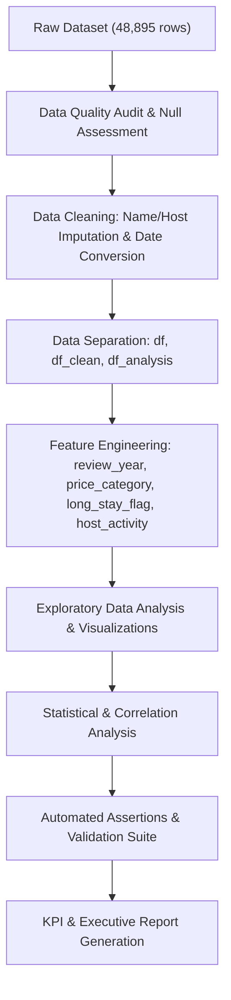
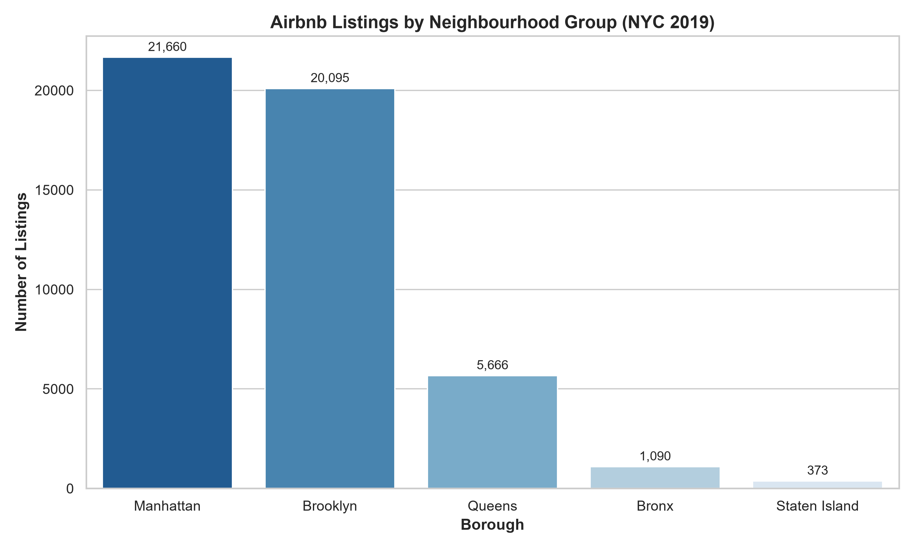
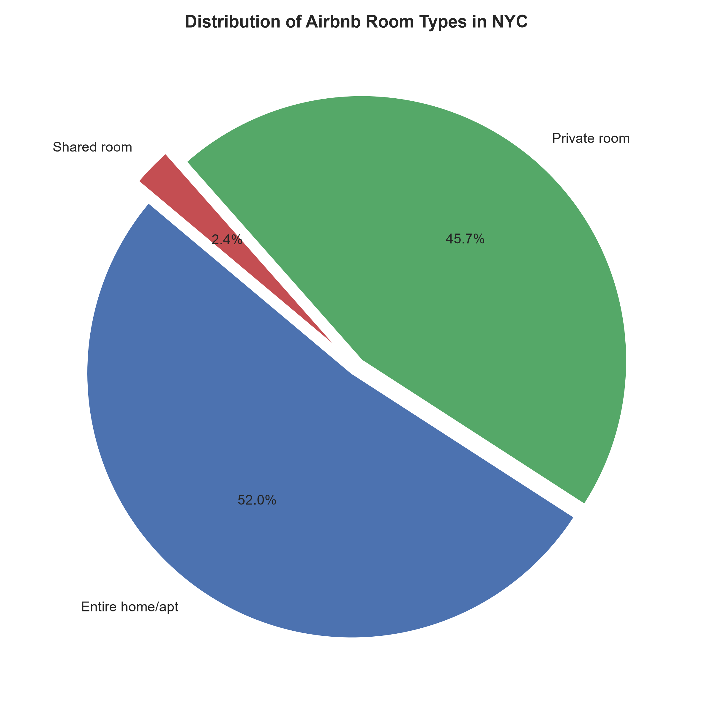
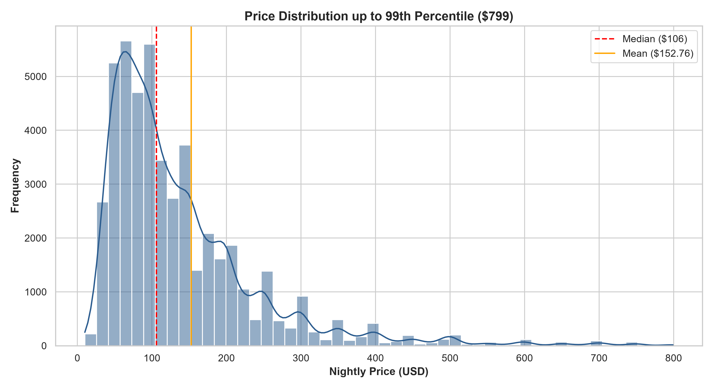
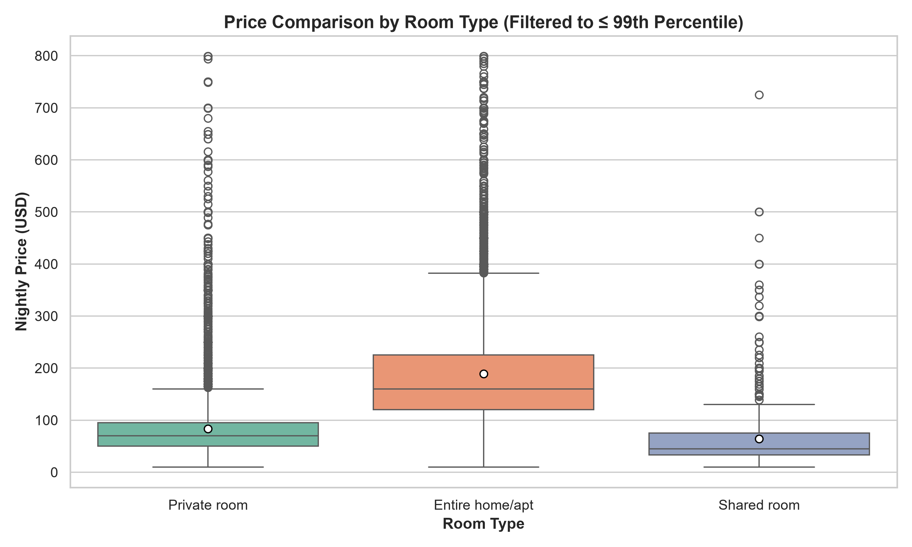
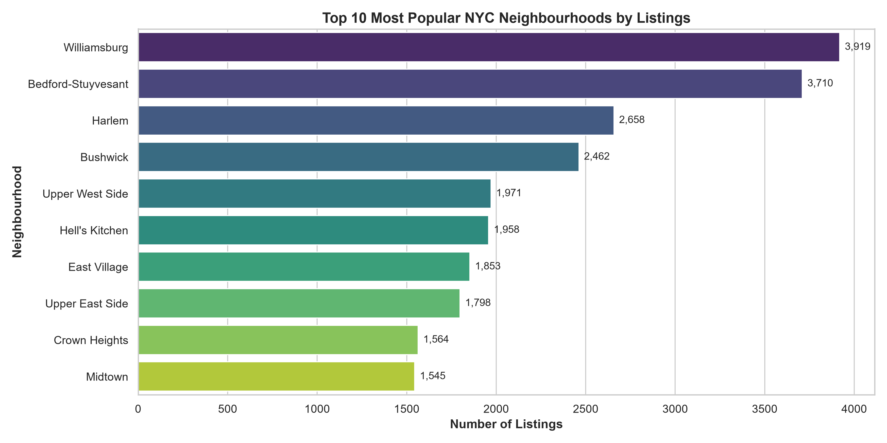
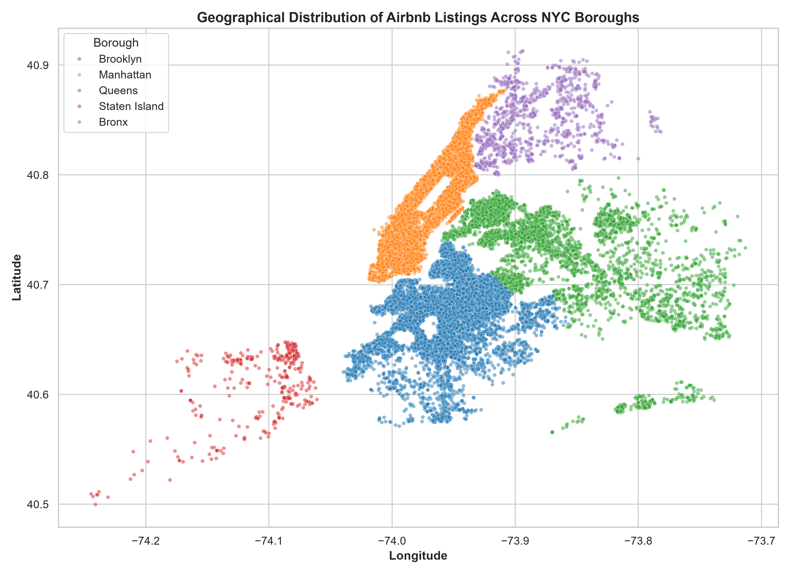
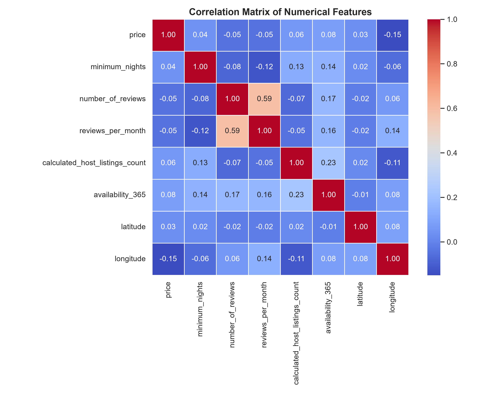
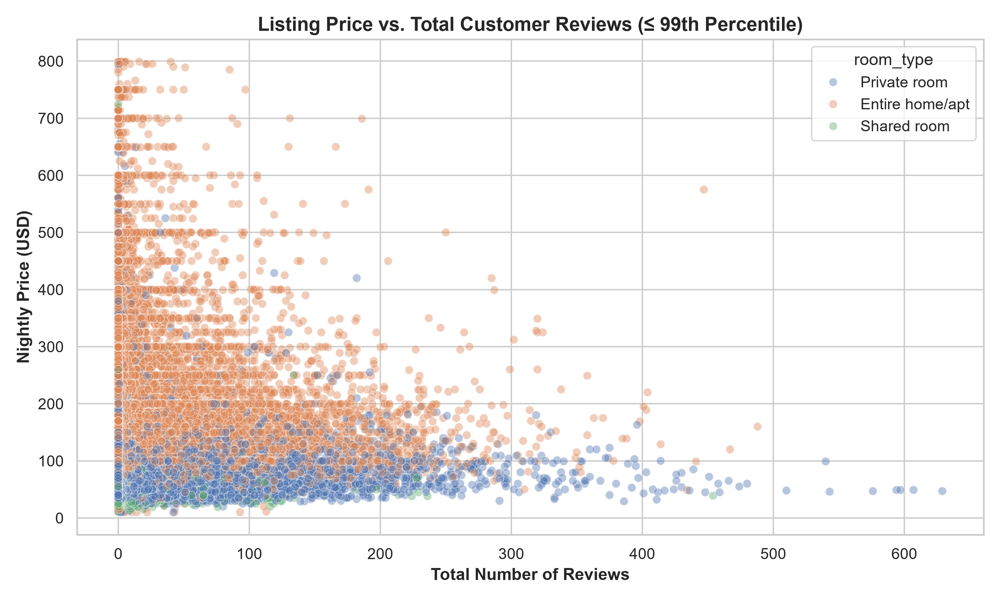
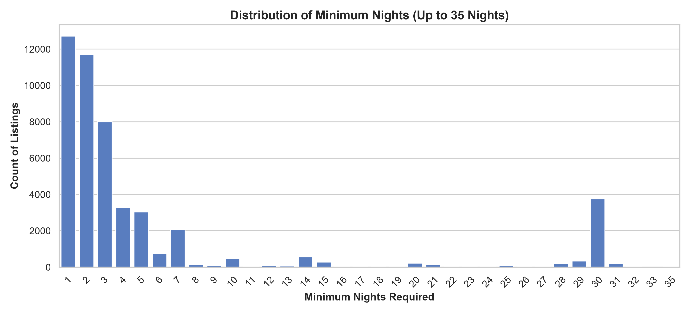

# 🗽 Airbnb NYC 2019 – Exploratory Data Analysis & Quality Audit

[](https://www.python.org/)
[](https://pandas.pydata.org/)
[](https://seaborn.pydata.org/)
[](https://opensource.org/licenses/MIT)
[-brightgreen.svg)]()

A comprehensive, end-to-end Exploratory Data Analysis (EDA), data cleaning pipeline, feature engineering framework, and statistical validation audit of **48,895 Airbnb listings** across New York City in 2019.

---

## 📌 Problem Statement

The short-term rental market in New York City is highly dynamic, influenced by geographical location, property types, regulatory limits, and host management practices. Understanding market supply, pricing outliers, and customer demand is essential for property managers, travelers, and regulatory bodies.

This project delivers:
1. An empirical data quality audit identifying missingness, anomalies, and outliers.
2. A reproducible cleaning and feature engineering pipeline producing analysis-ready datasets.
3. Advanced geospatial, correlation, and categorical exploratory analyses.
4. Quantitative business KPIs and automated Python assertion testing.

---

## 🎯 Objectives

- **Market Landscape:** Quantify listing volumes and distributions across all 5 NYC boroughs and 221 neighbourhoods.
- **Pricing Patterns:** Evaluate price elasticity, borough premiums, and room-type price variances while managing extreme outlier skews.
- **Supply Dynamics:** Analyze the split between Entire Homes, Private Rooms, and Shared Rooms.
- **Host Behavior:** Characterize single-property vs. commercial multi-property operators.
- **Customer Engagement:** Measure review volumes, velocity (`reviews_per_month`), and seasonality.
- **Feature Engineering:** Derive regulatory stay flags, price tiers, and host classification tiers.
- **Quality Assurance:** Validate data integrity using automated assertions.

---

## 📁 Repository Structure

```text
Airbnb-NYC-2019-EDA/
│
├── data/
│   └── README.md                         # Dataset schema, source, and download instructions
│
├── notebooks/
│   └── Airbnb_NYC_2019_EDA.ipynb         # Full interactive Jupyter / Colab analysis notebook
│
├── outputs/
│   ├── airbnb_kpis.csv                   # Executive platform KPIs and benchmarks
│   ├── missing_values_report.csv         # Audit report of column null counts and percentages
│   ├── correlation_matrix.csv            # Correlation matrix across all numerical attributes
│   ├── top_hosts.csv                     # Top 10 commercial operators by portfolio volume
│   └── project_summary.txt               # Automated executive findings summary
│
├── visualizations/
│   ├── borough_listings.png              # Listings count by NYC Borough
│   ├── room_type_distribution.png        # Market share by room type
│   ├── price_distribution.png            # Density distribution up to 99th percentile
│   ├── correlation_heatmap.png           # Feature correlation matrix heatmap
│   ├── neighbourhood_analysis.png        # Top 10 neighbourhoods by listing count
│   ├── price_by_room_type.png            # Boxplot comparison of prices across room types
│   ├── minimum_nights.png                # Distribution of minimum reservation nights
│   ├── reviews_analysis.png              # Price vs. review volume scatter plot
│   └── geographical_distribution.png     # Geospatial listing map of NYC
│
├── src/
│   ├── __init__.py                       # Package initialization
│   └── analysis.py                       # Modular, production-grade Python pipeline script
│
├── README.md                             # Comprehensive project documentation
├── requirements.txt                      # Pinned Python package dependencies
└── .gitignore                            # Standard Git ignore configurations
```

---

## 💾 Dataset Details

- **Dataset Name:** New York City Airbnb Open Data (2019)
- **Source:** [Kaggle Dataset Link](https://www.kaggle.com/datasets/dgomonov/new-york-city-airbnb-open-data)
- **Raw File:** `AB_NYC_2019.csv`
- **File Size:** ~7.08 MB
- **Dimensions:** 48,895 rows × 16 columns

> For detailed schema definitions and instructions on acquiring the dataset, refer to [data/README.md](data/README.md).

---

## ⚙️ Technologies Used

- **Language:** Python 3.10+
- **Data Manipulation:** `pandas`, `numpy`
- **Visualization:** `matplotlib`, `seaborn`
- **Environment:** Jupyter Notebook, Google Colab, VS Code
- **Version Control:** Git & GitHub

---

## 🔬 Methodology & Pipeline



### 1. Data Cleaning (`df_clean` & `df_analysis`)
- **Preservation:** Raw data preserved untouched in `df`.
- **Duplicate Records:** Detected and verified 0 duplicate rows and 0 duplicate IDs.
- **Text Imputation:** Missing `name` fields (16 records) replaced with `"Unknown Listing"`; missing `host_name` (21 records) replaced with `"Unknown Host"`.
- **Review Imputation:** Missing `reviews_per_month` (10,052 records) imputed with `0.0` for listings with 0 reviews.
- **Date Conversion:** `last_review` converted to `datetime64`, retaining unreviewed listings as `NaT`.
- **Analytical Filtering (`df_analysis`):** Excluded 11 unlisted records with `price <= 0` ($0/night). Confirmed all geographic coordinates lie within NYC bounds (Latitude: 40.4–41.0, Longitude: -74.3 to -73.6).
- **Minimum Nights:** Flagged unusually high values (`> 365 nights`) rather than deleting valid extended stays.

### 2. Feature Engineering
- `review_year`: Extracted integer year from `last_review` for temporal cohort analysis.
- `price_category`: Stratified listings into four tiers: `Budget` (< \$75), `Standard` (\$75–\$150), `Premium` (\$151–\$300), and `Luxury` (> \$300).
- `long_stay_flag`: Boolean flag identifying listings requiring 30+ nights, aligning with NYC Short-Term Rental Regulations (Local Law 18).
- `host_activity`: Categorized hosts into `Single Listing` (1 unit), `Multi-Listing` (2–4 units), and `Commercial Operator` (5+ units).

---

## 📊 Key Business Performance Indicators (KPIs)

*Metrics calculated directly from `df_analysis` (48,884 verified records):*

| KPI Metric | Value | Business Interpretation |
| :--- | :--- | :--- |
| **Total Analyzed Listings** | **48,884** | Total active NYC inventory in 2019 |
| **Unique Hosts** | **37,455** | Demonstrates high individual host participation |
| **Average Nightly Price** | **\$152.76** | Influenced upward by luxury outliers (max \$10,000) |
| **Median Nightly Price** | **\$106.00** | True central tendency of typical consumer pricing |
| **Average Minimum Stay** | **7.03 nights** | Reflects blend of weekend getaways and medium stays |
| **Total Cumulative Reviews** | **1,137,628** | Significant consumer activity and platform trust |
| **Average Annual Availability** | **112.78 days** | Platform occupancy / calendar blocking index |
| **Number of Neighbourhoods** | **221** | Comprehensive coverage across all five boroughs |

---

## 📈 Visualizations Gallery

### 1. Market Supply & Borough Concentration
Manhattan and Brooklyn account for **85.4%** of the entire NYC short-term rental market.

| Borough Listings Breakdown | Room Type Market Share |
| :---: | :---: |
|  |  |

---

### 2. Pricing Dynamics & Outlier Analysis
Right-skewed pricing distribution: median is \$106.00, but luxury listings reach up to \$10,000/night.

| Price Distribution (≤ 99th Percentile) | Price by Room Type |
| :---: | :---: |
|  |  |

---

### 3. Geographical Mapping & Neighbourhood Hotspots
Williamsburg, Bedford-Stuyvesant, and Harlem lead citywide in total listing volume.

| Top 10 Neighbourhoods | NYC Geographical Distribution |
| :---: | :---: |
|  |  |

---

### 4. Correlation & Booking Characteristics

| Correlation Heatmap | Price vs. Reviews (Demand Dynamics) |
| :---: | :---: |
|  |  |

| Minimum Nights Requirement |
| :---: |
|  |

---

## 💡 Executive Business Insights

1. **Borough Dominance:**  
   **Manhattan** represents 44.3% of listings (21,660) and commands the highest average nightly rate (\$196.88). **Brooklyn** follows closely with 41.1% (20,095 listings) at an average of \$124.38. Together, they form 85.4% of market inventory.
2. **Room Type Preferences:**  
   **Entire home/apt** (52.0%) and **Private room** (45.7%) comprise 97.7% of all accommodations. Shared rooms (2.4%) represent a niche budget segment.
3. **Commercial Host Footprint:**  
   The top host (*Sonder (NYC)*) controls **327 listings** with an average price of \$253.20. Commercial operators (hosts with 5+ units) command significant market power in central tourist zones.
4. **Demand & Review Velocity:**  
   20.6% of listings (10,051) have zero reviews, representing either newly onboarded units or dormant properties.
5. **Correlation Insights:**  
   Listing price exhibits weak linear correlation with review count (r = -0.05), indicating that high review counts do not artificially inflate prices; rather, competitively priced units gather reviews faster.

---

## 🧪 Automated Validation & Testing

The pipeline executes automated Python assertions in `src/analysis.py` and `notebooks/Airbnb_NYC_2019_EDA.ipynb`:

```python
# Validation Suite Summary
assert df_clean["id"].nunique() == len(df_clean)                                # Unique IDs
assert df_clean.duplicated().sum() == 0                                         # Zero duplicates
assert df_clean["name"].isnull().sum() == 0                                     # Zero null names
assert df_clean["host_name"].isnull().sum() == 0                                 # Zero null hosts
assert (df_analysis["price"] <= 0).sum() == 0                                   # Strictly positive prices
assert df_analysis["latitude"].between(40.4, 41.0).all()                        # Valid latitude bounds
assert df_analysis["longitude"].between(-74.3, -73.6).all()                     # Valid longitude bounds
assert not np.isinf(df_analysis[num_cols]).any().any()                          # Zero infinite values
```

**Test Result:** `8 / 8 Checks PASSED (100% Pass Rate)`.

---

## 🚀 Installation & Execution

### Prerequisites
- Python 3.10 or higher
- Git

### 1. Clone the Repository
```bash
git clone https://github.com/Kathir18M/Airbnb-NYC-2019-EDA.git
cd Airbnb-NYC-2019-EDA
```

### 2. Set Up a Virtual Environment
```bash
# Windows (PowerShell)
python -m venv venv
.\venv\Scripts\Activate.ps1

# macOS / Linux
python3 -m venv venv
source venv/bin/activate
```

### 3. Install Dependencies
```bash
pip install -r requirements.txt
```

### 4. Run the Pipeline
Run the modular production script from the command line:
```bash
python src/analysis.py
```

### 5. Launch the Notebook
To explore interactively in Jupyter:
```bash
jupyter notebook notebooks/Airbnb_NYC_2019_EDA.ipynb
```

---

## 👤 Author

**Kathir Dhivaghar**  
*Data Analyst & Python Developer*  
GitHub: [@Kathir18M](https://github.com/Kathir18M)  
Repository: [Airbnb-NYC-2019-EDA](https://github.com/Kathir18M/Airbnb-NYC-2019-EDA)

---

## 📄 License
This project is open-source and available under the [MIT License](LICENSE).
